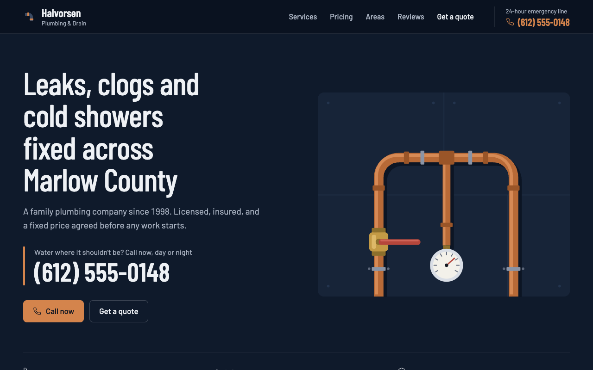

# Halvorsen Plumbing & Drain: Astro plumber website template

A plumbing and trade business website with an always-visible emergency call button, services, a published pricing guide, areas served, sample reviews and a quote form. Static, fast, and no server needed.



[](https://console.cloudzyro.com/new?repo=https://github.com/Cloudzyro/template-plumber)

## What's included

- Home page with a drawn copper pipe run, the emergency line in large type, services, a pricing preview, areas served and sample reviews
- Tap-to-call: the phone number sits in the header on desktop and in a bar fixed to the bottom of the screen on phones
- Services page with what each job includes, pricing guide with the service call, hourly labor, after-hours rate and price ranges for common jobs
- Areas served page with towns and ZIP codes, and a reviews page (sample reviews, clearly marked)
- Quote form (name, phone, email, job address, job type, urgency and a description) that posts to a form service of your choice, with shutoff advice shown when someone picks "emergency"
- Plumber structured data (schema.org), Open Graph tags, sitemap, robots.txt, favicon and a 404 page
- Responsive down to 360px, keyboard friendly, reduced motion respected
- Illustrations are SVG drawn in code, so there are no photos to license

## Run it locally

```bash
pnpm install
pnpm dev        # http://localhost:4321
pnpm build      # static site in dist/
pnpm preview
```

## Make it yours

- **Content:** everything is in `src/data/site.ts`: the business name, phone number, email, address, license number, hours, services, prices, towns and ZIP codes, and reviews. The license number and reviews are samples; replace them with your own before going live.
- **Quote form:** set `PUBLIC_FORM_ENDPOINT` to a form endpoint from Formspree, Basin, a Supabase function or similar. The form sends `name`, `phone`, `email`, `address`, `job`, `urgency` and `description` as form data. With no endpoint set, the form shows a short note and opens the visitor's email app addressed to the email in `src/data/site.ts`.
- **Site address:** set `SITE_URL` (for example `https://www.halvorsenplumbing.com`) so the sitemap, canonical links and social previews use your domain.
- **Colors and fonts:** colors are CSS variables at the top of `src/styles/global.css`. Fonts are Barlow Condensed for headlines and Barlow for everything else, self-hosted with Fontsource and imported in `src/layouts/Base.astro`.
- **Social preview image:** replace `public/og.png` (1200 x 630).

Environment variables are read at build time. Locally, put them in `.env` (see `.env.example`):

```bash
PUBLIC_FORM_ENDPOINT=https://formspree.io/f/your-id
SITE_URL=https://www.halvorsenplumbing.com
```

## Deploy

Click the Deploy button above, or push your own copy to GitHub and connect it in the Cloudzyro console. Add the environment variables in your site's settings. The build command is `pnpm build` and the output folder is `dist/`, a plain static site.

## Stack

- Astro 7 (static output)
- @astrojs/sitemap
- Fontsource (Barlow Condensed, Barlow)
- TypeScript, plain CSS

MIT licensed. See [LICENSE](./LICENSE).
